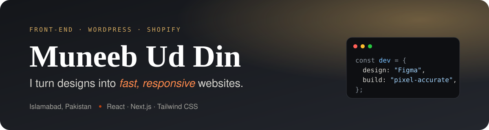
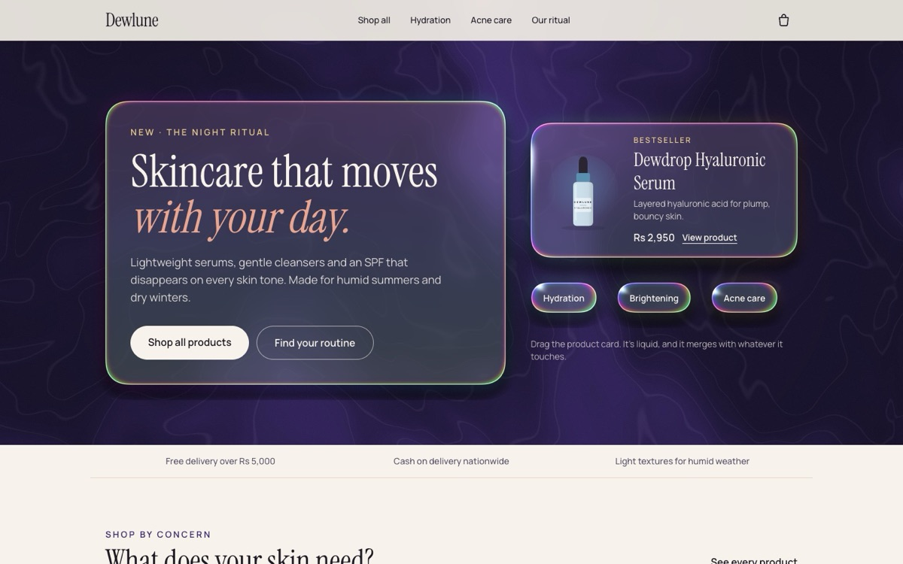
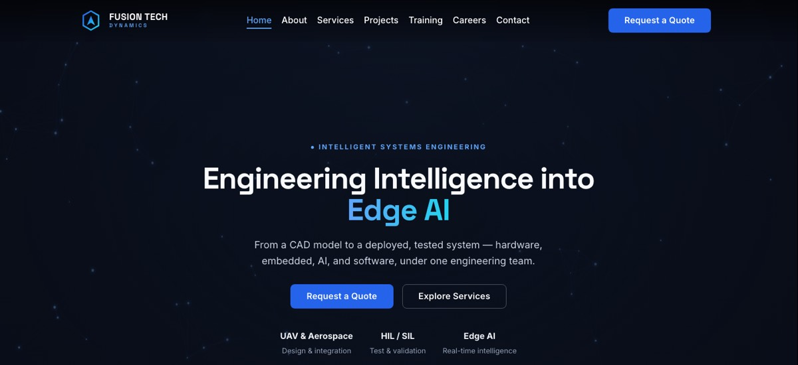
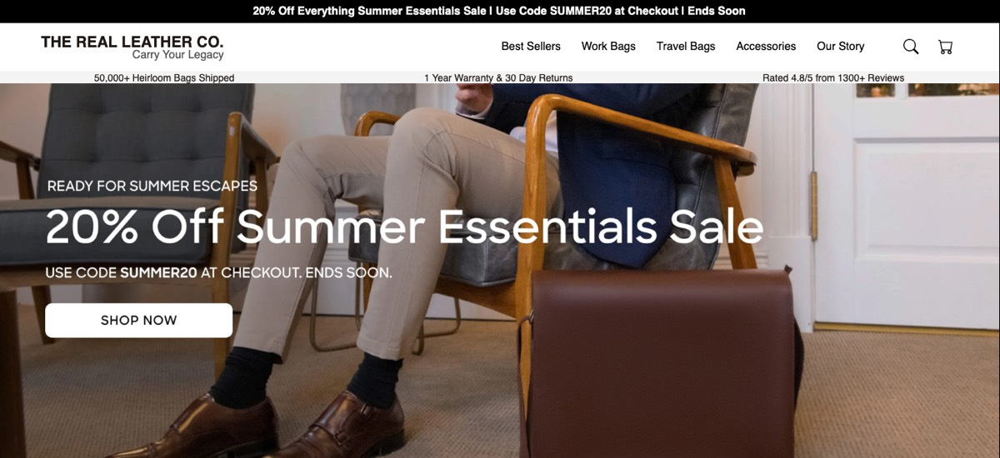

  

<h1 align="center">Hey 👋, I'm Muneeb Ud Din</h1>

  

  I'm a front-end developer from <b>Islamabad, Pakistan</b> 🇵🇰 with a B.S. in Computer Science. 
  I turn Figma and reference designs into fast, responsive websites, and I work across
  <b>WordPress</b>, <b>Shopify</b> and modern <b>React / Next.js</b>. 
  I care about clean, reusable code that looks right on every screen.

  
  
  

---

### 🚀 What I'm up to

- 🛍️ Latest project: **[Dewlune](https://github.com/muneebuddinzamir-bit/dewlune)**, a headless WooCommerce store with Next.js and liquid-glass UI
- 💼 Junior Front-End Developer at **Fusion Tech Dynamics**, building a Next.js dashboard from Figma designs
- 🛠️ Freelance front-end work: company websites, online stores and landing pages
- 🌱 Growing my back-end skills with **Node.js / Express**, **MongoDB** and **Supabase**
- 🎓 B.S. Computer Science, Iqra University Islamabad (2025)
- 💬 Ask me about responsive layouts, Figma-to-code, WordPress and Shopify themes

### 🧰 Tech stack

**Front-end**

**CMS & e-commerce**

**Back-end & tools**

### ✨ Featured projects

#### 🌙 Dewlune: headless WooCommerce store

A skincare storefront where the shopping experience is **Next.js** and the products, cart and checkout come from **WordPress + WooCommerce** through the Store API. The home page hero uses **Plasma UI** liquid-glass panels rendered in WebGL, loaded only on desktop.

- Real cart and cash-on-delivery checkout that creates orders in WooCommerce admin
- Server routes keep the cart token in an httpOnly cookie, so the browser never talks to WordPress
- Docker setup with a WP-CLI seeder and a custom must-use plugin for Pakistani address rules
- Demo mode that runs without a backend

<code>Next.js 16</code> <code>React 19</code> <code>TypeScript</code> <code>Tailwind CSS</code> <code>WooCommerce</code> <code>WordPress</code> <code>PHP</code> <code>Docker</code> <code>Plasma UI</code>

**[View code ↗](https://github.com/muneebuddinzamir-bit/dewlune)**

 

<table>
  <tr>
    <td width="50%" valign="top">
      
      <h4>🌐 Fusion Tech Dynamics</h4>
      Multi-page responsive company website, taken from design to deployment. Scores 99 for performance and 100 for SEO on desktop in Google Lighthouse.  
      <code>HTML</code> <code>CSS</code> <code>JavaScript</code> <code>Cloudflare Pages</code>  
      <a href="https://fusiontechdynamics.com"><b>Live site</b></a> · <a href="https://github.com/muneebuddinzamir-bit/FTD"><b>Code</b></a>
    </td>
    <td width="50%" valign="top">
      
      <h4>🛍️ The Real Leather Co</h4>
      E-commerce storefront rebuilt from a reference design: product catalog, product cards, navigation, cart and checkout interface.  
      <code>HTML</code> <code>CSS</code> <code>JavaScript</code> <code>E-commerce UI</code>  
      <a href="https://github.com/muneebuddinzamir-bit/therealleatherbymuneeb"><b>Code</b></a>
    </td>
  </tr>
</table>

| Project | What it is | Stack | Links |
|---|---|---|---|
| 📋 **Job Application Tracker** | Full-stack app with accounts, a status board and row-level security | Next.js, TypeScript, Tailwind, Supabase | [Live demo](https://job-tracker-rouge-three.vercel.app) · [Code](https://github.com/muneebuddinzamir-bit/job-tracker) |
| 🛒 **E-Commerce Platform** | Storefront with product listing and a cart saved in localStorage | HTML, CSS, JavaScript | [Code](https://github.com/muneebuddinzamir-bit/E-Commerce-Platform) |
| 🧠 **Interactive Quiz App** | Quiz app with sound feedback | HTML, CSS, JavaScript | [Code](https://github.com/muneebuddinzamir-bit/Interactive-Quiz-App) |
| 👥 **User Directory** | Loads and displays users from a REST API | HTML, CSS, JavaScript | [Code](https://github.com/muneebuddinzamir-bit/User-Directory) |

### 📫 Let's connect

I'm open to **front-end and WordPress roles** and **freelance projects**.

- 📧 Email: [muneebuddin.zamir@gmail.com](mailto:muneebuddin.zamir@gmail.com)
- 💼 LinkedIn: [linkedin.com/in/muneeb-ud-din-0258a235](https://linkedin.com/in/muneeb-ud-din-0258a235)

<i>Thanks for stopping by ⭐</i>

